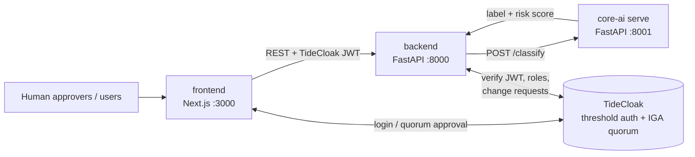

## Project overview

### What new product, service, experience or way of working are you proposing? What makes your idea distinctive?

QuorumGate for Agents lets organisations give AI agents real authority without trusting the agent, one admin or one server. An agent proposes high-impact actions; our multilingual prompt-attack classifier (Challenge 1) scores the triggering text and sets the approval tier: low risk auto-executes, medium needs one approver, high needs a TideCloak-enforced quorum. Authority is risk-adaptive and quorum-bound.

### What is difficult, risky or impossible today because trust, privacy or security gets in the way? Explain what becomes possible when that constraint is removed.

One injected email can make an agent wire money or export data, and today's "approval" is a database flag that one admin or compromised backend can forge. Classifiers miss attacks (EchoLeak), so teams either withhold authority from agents or hand it to a single point of failure. With that removed, agents can do high-impact work because even a missed attack cannot exercise authority nobody holds alone.

### Who would benefit, and how would their lives or work improve? Give a concrete example of why this matters.

Finance and operations teams, and the people whose money and data agents touch. Example: an accounts-payable agent reads a Vietnamese invoice email hiding a beneficiary-change instruction. The classifier flags PROMPT_INJECTION, the payment becomes a quorum request, and two officers must approve the exact payload. Routine invoices still flow automatically, limiting approval fatigue. <!-- TODO(team): confirm final demo scenario -->

### How does your application use TideCloak, and how does that integration help enable your idea? Connect the technology to the possibility you are demonstrating.

The agent runs under a minimal-role Tide identity; elevation and role changes go through TideCloak quorum-approved change requests, and the backend verifies TideCloak-signed JWTs server-side. Without TideCloak, "N humans approved" is a forgeable database row. The classifier detects; TideCloak decides who may act. <!-- TODO(team): list exactly which TideCloak features are wired in (roles, IGA quorum, JWT verify, E2EE) and what is mocked. Forseti contracts are not self-service, so we do not rely on them. -->

### What does your prototype demonstrate today? Describe the key interaction judges should look for.

A Next.js UI, FastAPI backend and classifier service with TideCloak login. The risk signal comes from our Challenge 1 multilingual prompt-attack classifier (fine-tuned on one approved backbone, candidate FacebookAI/xlm-roberta-large; the prototype currently serves the TF-IDF baseline, macro-F1 0.922 CV). Watch for: a benign action auto-executes; a risky one needs one approver; an injected non-English one stays blocked until a quorum approves; a lone admin trying to approve alone fails. <!-- TODO(team): update to what actually works at submission; real actions (e.g. payments) are mocked and the classifier has false negatives. -->

Demo video (2 min): [`docs/demo.mp4`](docs/demo.mp4) <!-- TODO(team): record, export .mp4 (<100 MB), commit at this path -->

---

# QuorumGate for Agents

> RMIT Hackathon 2026: Challenge 1 (multilingual prompt-attack classifier) + Challenge 2 (Tide UNLOCKED, built with TideCloak).

[](https://tide.org/tidecloak?utm_source=github&utm_medium=readme&utm_campaign=unlocked)

## Architecture



```
agent proposes action + triggering text
        │
        ▼
 backend ──► core-ai /classify ──► BENIGN            → auto-execute
                                 ► medium risk       → 1 approver
                                 ► JAILBREAK / PROMPT_INJECTION → TideCloak quorum (e.g. 2-of-3)
```

## Repo structure

| Path | Challenge | Purpose |
|---|---|---|
| `core-ai/` | 1 (+2 serving) | Kaggle multilingual prompt-attack classifier: uv project, Modal GPU training, submissions; also the inference API (`rmit_hack.serve:app`, port 8001, `POST /classify`) used by Challenge 2 |
| `backend/` | 2 | FastAPI API (port 8000): TideCloak JWT auth, risk-tier and quorum/approval logic, calls core-ai |
| `frontend/` | 2 | Next.js UI (port 3000): agent action queue, approvals, TideCloak login |
| `docs/` | both | Challenge briefs, research (`docs/research/`), demo video (`docs/demo.mp4`) |

## Quickstart

Run each service in its own terminal.

```bash
# core-ai (classifier inference, port 8001)
cd core-ai && uv sync && uv run uvicorn rmit_hack.serve:app --port 8001

# backend (port 8000)
cd backend && uv sync && uv run uvicorn app.main:app --port 8000

# frontend (port 3000)
cd frontend && npm install && npm run dev
```

Copy each service's `.env.example` to `.env` (or `.env.local` for the frontend) and fill in TideCloak settings. <!-- TODO(team): document TideCloak realm/Docker setup once chosen -->

## Challenge 1 (Kaggle)

Training, data download, Modal GPU runs and submission steps live in [`core-ai/README.md`](core-ai/README.md).

### AI model & research

Rules allow exactly **one** approved pretrained backbone (no blending across backbones). Metric: macro-F1 (BENIGN / JAILBREAK / PROMPT_INJECTION), 6 submissions total. Screening 1 fold each on Modal L4; the winner by OOF macro-F1 gets a 5-fold run. **Final pick: TODO.**

| Backbone | Status |
|---|---|
| `FacebookAI/xlm-roberta-large` | Primary candidate |
| `jhu-clsp/mmBERT-base` | Screening |
| `patronus-studio/wolf-defender-prompt-injection` | Screening (mmBERT fine-tuned for PI, 3-class head re-init) |
| `ibm-granite/granite-3.3-2b-instruct` (LoRA) | Stretch |
| protectai deberta, rembert, Mistral-7B, small models | Skipped / fallback |

Baseline (served by the prototype today): TF-IDF char+word + balanced LogisticRegression, StratifiedGroupKFold 5-fold, **macro-F1 0.922**.

Full write-up (Vietnamese): [`core-ai/research/RESEARCH_SUMMARY.md`](core-ai/research/RESEARCH_SUMMARY.md). Notes: [EDA](core-ai/research/C1_eda.md), [backbones](core-ai/research/C1_backbones.md), [techniques](core-ai/research/C1_techniques.md), [domain/rules](core-ai/research/C1_domain.md), [multilingual PI survey](core-ai/research/B_multilingual_pi.md).

## Team setup notes (Vietnamese)

- **Modal:** mỗi người chạy `uv run modal setup` (hoặc `modal profile activate <profile>`) trong `core-ai/` để dùng đúng workspace; GPU training dùng L4.
- **Kaggle:** đặt token ở `~/.kaggle/access_token` (hoặc `~/.kaggle/kaggle.json`). **Không bao giờ commit** token, `.env`, `.modal.toml`. `.gitignore` đã chặn các file này.
- **Dữ liệu:** `core-ai/data/raw|processed` không commit (chỉ giữ `.gitkeep`); tải bằng `core-ai/scripts/download_data.sh`.
- **Secrets TideCloak / Modal / Kaggle** chia sẻ qua kênh riêng của team, không đưa vào repo.

## Deadlines

Both challenges close at **18:00 Vietnam time, Thursday 22 October 2026** (Melbourne: 10:00 AEDT, 23 Oct). Challenge 2 submission = public GitHub repo containing the 2-minute demo `.mp4` + README Project overview, submitted via the [Google Form](https://forms.gle/HRHYjnqB86j1LFS97). Support: [Tide Discord](https://discord.gg/XBMd9ny2q5).

## Docs

- [`docs/challenge2-brief.md`](docs/challenge2-brief.md) — Challenge 2 brief
- [`docs/research/`](docs/research/) — idea selection, Tide facts, security-gap evidence
